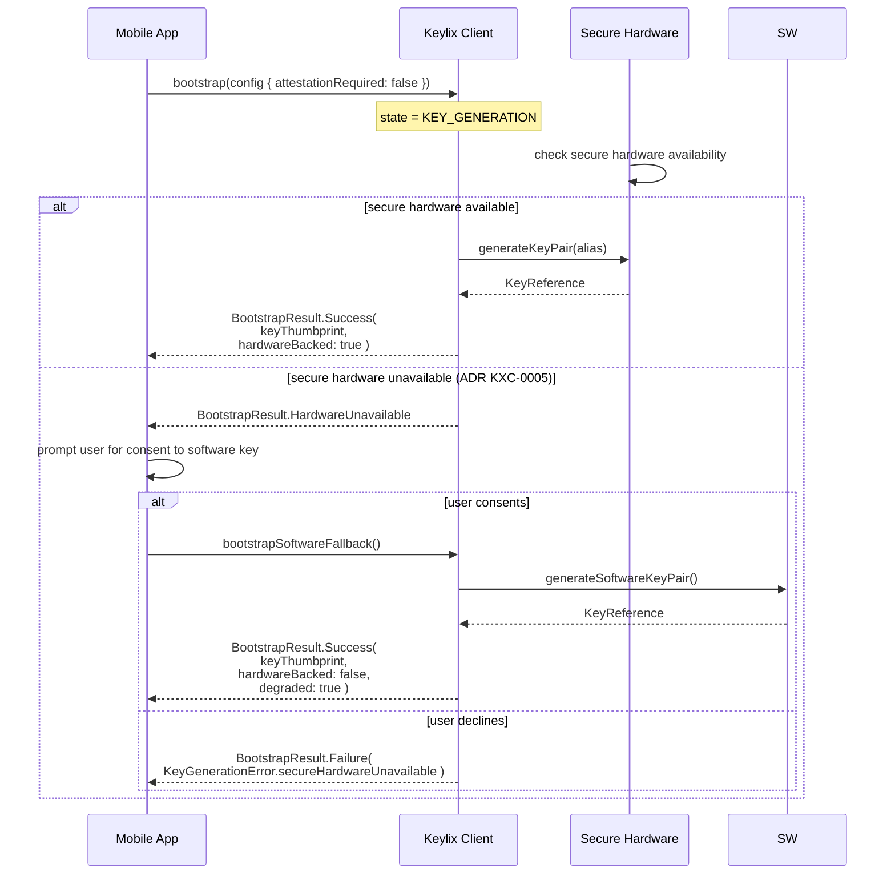
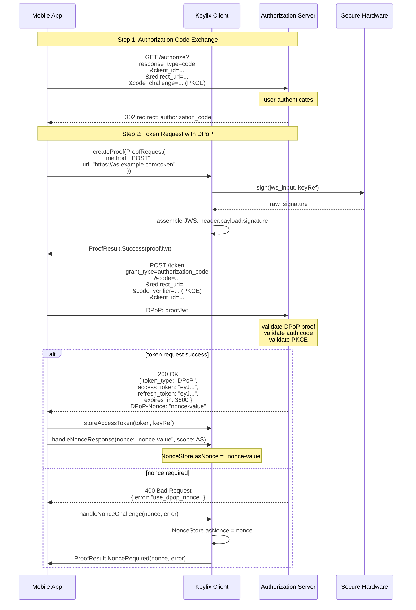
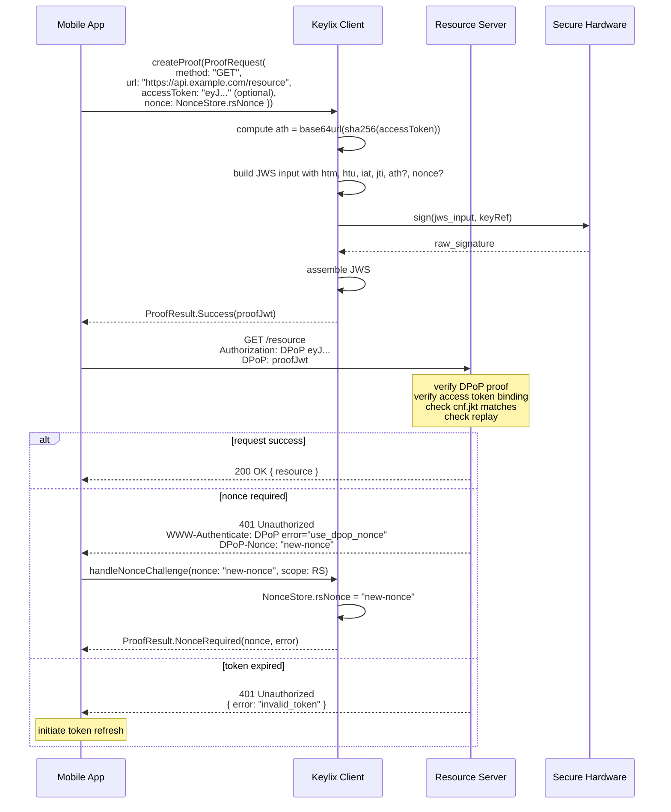
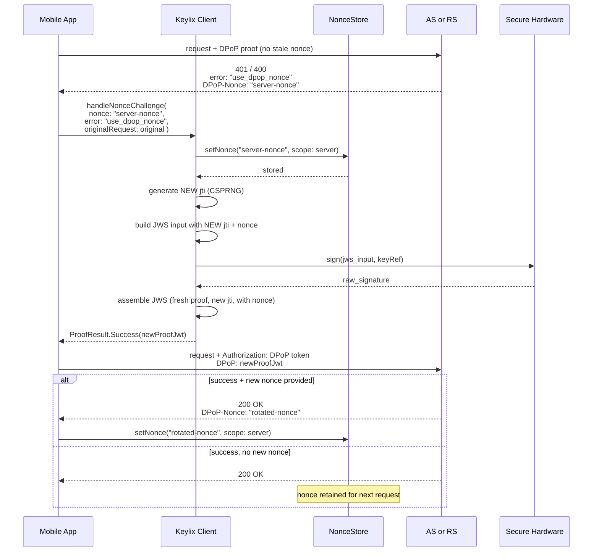
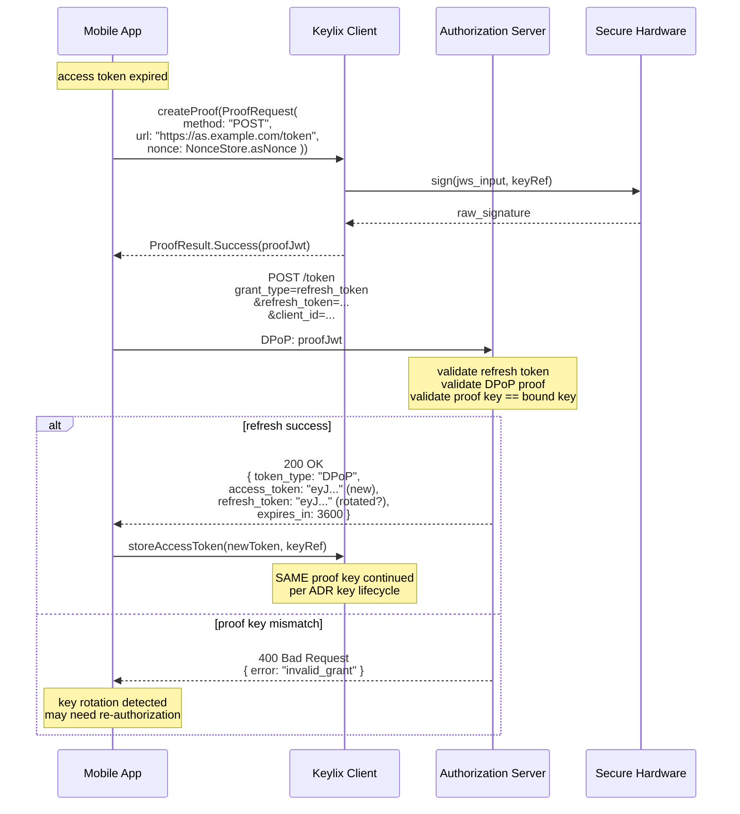
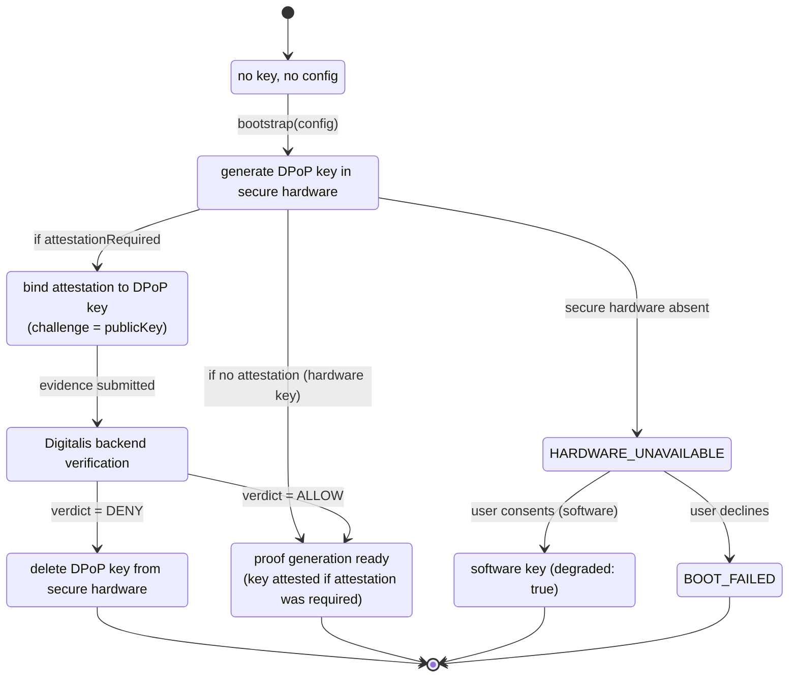
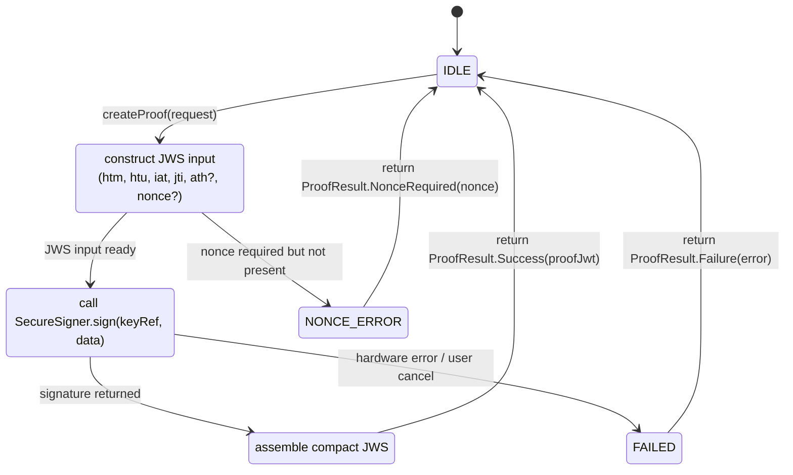

# Protocol Flows

> **Keylix Client scope.** Covers mobile/desktop SDK flows (bootstrap, attestation, token binding, nonce retry) only. The canonical protocol-level flows live in the public [`keylix-community`](https://github.com/hackelia-micrantha/keylix-community) repository: [docs/PROTOCOL_FLOWS.md](https://github.com/hackelia-micrantha/keylix-community/blob/main/docs/PROTOCOL_FLOWS.md). On any conflict, the public canonical source governs.

**Status:** design phase — initial baseline.

This document defines the normative protocol flows for Keylix Client, showing the exact message sequencing between the mobile SDK, the Digitalis attestation backend, the authorization server (AS), and the resource server (RS).

## 1. Bootstrap Flow (with Attestation)

The full high-assurance bootstrap flow. This is the "happy path" when attestation is required.

```mermaid
sequenceDiagram
    participant App as Mobile App
    participant SDK as Keylix Client
    participant Attestor as Platform Attestor<br/>(App Attest / Play Integrity)
    participant DI as Digitalis Backend
    participant KS as Secure Hardware<br/>(Enclave / StrongBox)

    App->>SDK: bootstrap(config { attestationRequired: true })

    Note over SDK: state = KEY_GENERATION

    SDK->>KS: generateKeyPair(alias: "dpop-proof-key")
    KS-->>SDK: KeyReference(alias)

    SDK->>KS: exportPublicKeyJwk(keyRef)
    KS-->>SDK: Jwk { kty, crv, x, y }

    Note over SDK: compute RFC 7638 thumbprint (jkt)

    Note over SDK: state = ATTESTING

    SDK->>DI: POST /verify<br/>{ contract_version, sdk_version, project_id }

    DI-->>SDK: { attestation_challenge: nonce, ttl }

    Note over SDK: bind attestation to the DPoP key

    SDK->>Attestor: generateAttestation(challenge, dpopPublicKey)
    Note right of Attestor: Android: setAttestationChallenge(publicKey)<br/>iOS: clientDataHash = SHA-256(publicKey)
    Attestor->>KS: create attestation evidence bound to existing key
    KS-->>Attestor: attestation artifact (cert chain / assertion)
    Attestor-->>SDK: attestation_token

    SDK->>DI: POST /verify<br/>{ attestation: attestation_token,<br/>  key_thumbprint: jkt }

    DI->>DI: verify evidence<br/>check key in attestation<br/>matches presented key<br/>evaluate policy

    alt verdict = ALLOW
        DI-->>SDK: { verdict: ALLOW, ttl: 1800, config_ref }

        Note over SDK: state = TRUSTED_ACTIVE

        SDK-->>App: BootstrapResult.Success(<br/>  keyThumbprint: jkt,<br/>  hardwareBacked: true,<br/>  attestation: ALLOW )

    else verdict = DENY
        DI-->>SDK: { verdict: DENY, reason: POLICY_DENIED }

        SDK->>KS: deleteKey(keyRef)
        Note over SDK: key destroyed; cannot be used

        SDK-->>App: BootstrapResult.Failure(<br/>  AttestationError.verdictDenied )
    end
```

## 2. Bootstrap Flow (without Attestation)

The standard bootstrap flow when attestation is not required. Faster, but lower assurance.



## 3. Token Request Flow (OAuth + DPoP)

The flow where the mobile app obtains a DPoP-bound access token from the authorization server.



## 4. Protected Resource Request Flow

The flow for making an API call with a DPoP-bound access token.



## 5. Nonce Retry Flow

The retry flow when the server requires or rotates a DPoP nonce.



## 6. Token Refresh Flow

When the access token expires, the mobile app refreshes it while maintaining DPoP binding.



## 7. Bootstrap State Machine



## 8. Proof Generation State Machine



## Key Invariants Across All Flows

1. **Fresh `jti` per proof.** Every call to `createProof` generates a new `jti`. Retries after nonce challenges ALWAYS use a new `jti`.

2. **Same key per bound session.** The refresh-token/DPoP-key relationship is stable. The SDK does not rotate the proof key mid-session.

3. **Nonce scoping.** AS nonce and RS nonce are independent. Each is only included in proofs sent to its respective server.

4. **`ath` is always current.** The access-token hash is computed from the exact token the caller is presenting — never from a cached/stale token.

5. **Proof key in JWK header.** The DPoP header contains the full public JWK, enabling the server to verify the signature and extract the `cnf.jkt` confirmation.

6. **No silent bearer fallback.** If proof generation fails, the request is not sent as bearer. The caller receives a `Failure` result.
